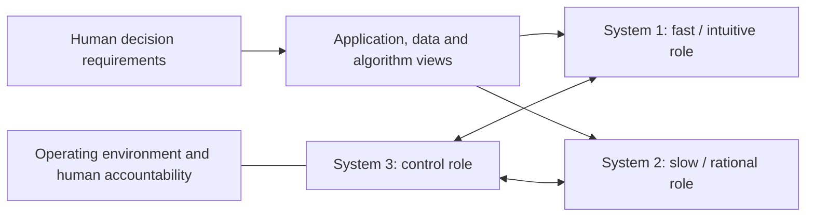

# Trimodal Thinking Guide

**An unofficial reading companion to _Trimodal Thinking for Architecting Human-Centric AI Systems: Fast, Slow and Control_ by Asif Gill.**

This guide explains the paper's argument, architectural vocabulary, decision catalog, automation patterns, and research questions for human readers and AI agents. It is a conceptual architecture paper: **there is no empirical evaluation of the proposed framework in the studied source, and this repository reports no experiments or reproduced implementation.**

> Research credit: **Asif Gill**, University of Technology Sydney. The manuscript biography names the same author **Asif Q. Gill**. Maintained by [0xHayd3n](https://github.com/0xHayd3n), with AI assistance; no affiliation with or endorsement by the author is implied.
>
> Studied source: **TechRxiv v1**, posted **13 November 2024**, 16 PDF pages including the repository cover. [Version DOI](https://doi.org/10.36227/techrxiv.173153092.25969269/v1) · [Official record](https://www.techrxiv.org/doi/10.36227/techrxiv.173153092.25969269) · [Versioned PDF endpoint](https://www.techrxiv.org/doi/pdf/10.36227/techrxiv.173153092.25969269/v1). The manuscript header says **16 November 2024**; the cover/posting date says 13 November. The attachment identifies itself as a **preprint that has not been peer reviewed**. This describes v1, not the status of later publications.

## The idea in one minute

Gill asks how to conceptualize an AI architecture around human decision needs before choosing a technology. He uses Daniel Kahneman's fast and slow thinking as two architectural roles: a pattern-driven response and a deliberate analysis. He proposes a third role for monitoring, coordinating, and switching control between them. This third role is meant to make governance and bias concerns explicit in the architecture. It is a proposal for organizing design conversations, not evidence that three software components reproduce human cognition. [III, PDF pp. 4-5](https://doi.org/10.36227/techrxiv.173153092.25969269/v1)

The roles then inform decision requirements and three connected views of a system: **applications, data, and algorithms**. The paper links these views to automation choices and an iterative enterprise architecture pipeline. [IV-VI, PDF pp. 5-13](https://doi.org/10.36227/techrxiv.173153092.25969269/v1)



This is an original teaching diagram summarizing III-IV; it is not a reproduction of a source figure or an implemented system. Its connections denote conceptual responsibilities, not a specified runtime algorithm. The paper's own Figure 1 uses nondirectional plain/dotted connections without arrowheads; this guide does not infer an execution sequence from it.

## Choose a reading route

| Goal | Module |
| --- | --- |
| Understand the question, fast/slow distinction, and intellectual background | [1. Concepts and context](docs/01-concepts-and-context.md) |
| Follow the control argument and all three architecture views | [2. Framework and architecture](docs/02-framework-and-architecture.md) |
| Understand automation levels and the enterprise pipeline | [3. Patterns and pipeline](docs/03-patterns-and-pipeline.md) |
| Audit what the source establishes and what remains untested | [4. Evidence and limitations](docs/04-evidence-and-limitations.md) |
| Locate every section, figure, table, reference group, and the biography | [5. Complete paper map](docs/05-paper-map.md) |
| Work through an original example and plan an evaluation | [6. Discussion and design exercises](docs/06-discussion-and-design.md) |
| Read with an AI agent | [AGENTS.md](AGENTS.md), [LLMS.txt](LLMS.txt), [paper metadata](metadata/paper.json), [claim index](metadata/claims.json) |

**Short route:** README → module 1 → module 4 → module 6.

**Architecture route:** modules 1-3 beside source III-VI → complete map → design exercise.

**Source-first route:** read the complete v1 PDF and use module 5 as a checklist. Page numbers here are **one-based PDF pages**. For manuscript pages 1-15, PDF page = printed page + 1; the repository cover is PDF page 1. No appendix appears in this attachment.

## What is proposed, and what is evidenced?

| Source contribution | Appropriate reading | Evidence boundary |
| --- | --- | --- |
| Add a control role to fast and slow thinking | A conceptual extension for architecture design | No proof of an independent third cognitive system or optimal controller |
| Capture the human decision before selecting AI | A requirements checklist, including automation level and bias | No study measuring checklist effectiveness |
| Connect application, data, and algorithm architecture | A high-level design decomposition | No deployed reference implementation or integration benchmark |
| Describe four automation levels | Five configurations, including two semi-automated variants; human System 3 at levels 1-3 and AI System 3 at level 4, with human accountability throughout | Levels 1-3 explicitly retain full human control; level 4 has no human intervention/control. No safety certification or experimentally established maturity ladder |
| Embed the framework in adaptive enterprise architecture | A proposed pipeline and research agenda | Expected social/economic benefits are not measured outcomes |

The paper's statement about more than 80% of AI projects failing is attributed to an external RAND source [36]. It is **not a measurement collected by this paper** and is not evidence that trimodal design improves success rates. See [evidence notes](docs/04-evidence-and-limitations.md#the-project-failure-statistic).

## Use this repository with an agent

```text
Read AGENTS.md and metadata/paper.json, then explain the proposed control role.
For each paper claim give its section and one-based PDF page.
Separate the author's proposal, background citations, and your interpretation.
Do not claim that control guarantees unbiased, stable, or safe decisions.
```

The [claim index](metadata/claims.json) records claim type, source locator, and limits. It deliberately contains no empirical result entries. The [source register](metadata/sources.json) separates the actual attachment from official public access links. [VERIFICATION.md](VERIFICATION.md) explains the checks and their scope.

## Contents and credit

The six reading modules are accompanied by [citation metadata](CITATION.cff), [BibTeX](references/paper.bib), [attribution and provenance](ATTRIBUTION.md), [contribution rules](CONTRIBUTING.md), a [license for original guide material](LICENSE), and an offline [integrity checker](scripts/validate_repository.py).

Cite **Gill (2024), TechRxiv v1**, for the research. Kahneman's dual-system account, principal-agent theory, homeostasis, control theory, and Neil D. Lawrence's _The Atomic Human_ are intellectual inputs credited in the source; they are not contributions of this guide. The [paper map](docs/05-paper-map.md#reference-reading-map) explains the role of all 40 source references without reproducing their text.

Original guide material is licensed **CC BY 4.0**. The attachment independently labels the preprint CC BY 4.0. This repository does not redistribute the source PDF, full paper text, original figures, or author code. The actual attachment text was read through Library, and the parent reviewer inspected all five figures and seven tables in the original PDF. Five tables extended beyond the page boundary; their off-page content was recovered using widened in-memory page canvases, visually checked, and incorporated without changing the original PDF. Public TechRxiv access was challenged during preparation, and no public/attachment binary comparison is claimed. See [provenance](metadata/paper.json).

## Check the guide

```bash
python scripts/validate_repository.py
```

The checker verifies required files, internal links and anchors, citation consistency, and structured source/claim integrity. It does not validate the framework. Prepared on **20 October 2026** using the established [Harness Learning Guide](https://github.com/0xHayd3n/harness-learning-guide) format.
